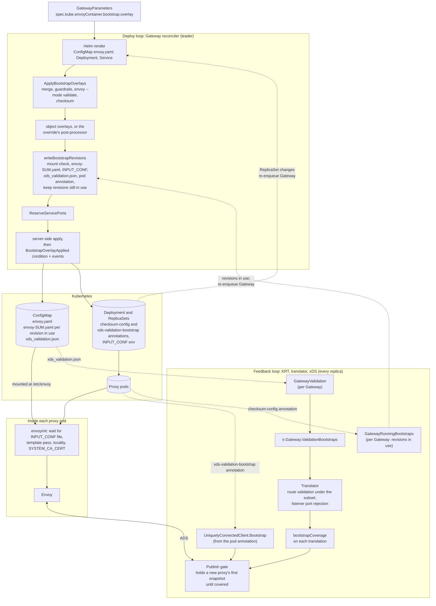
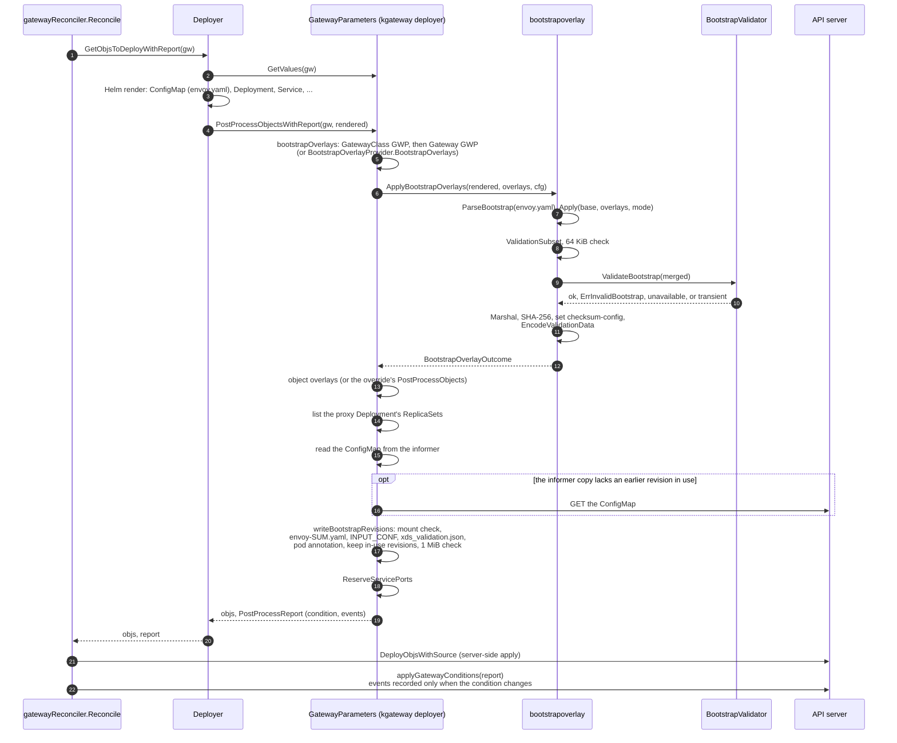
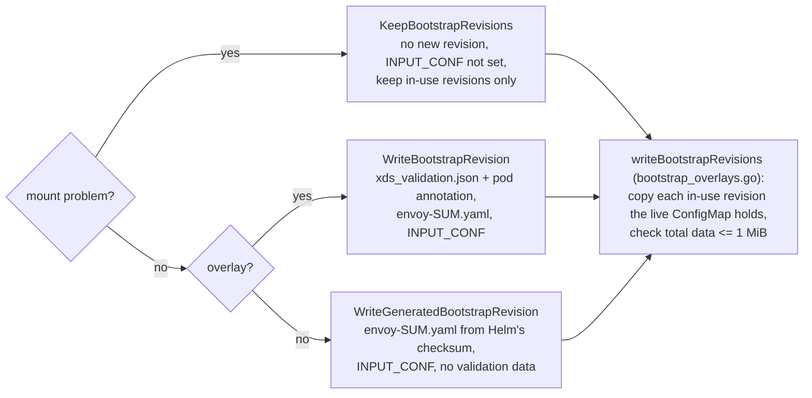
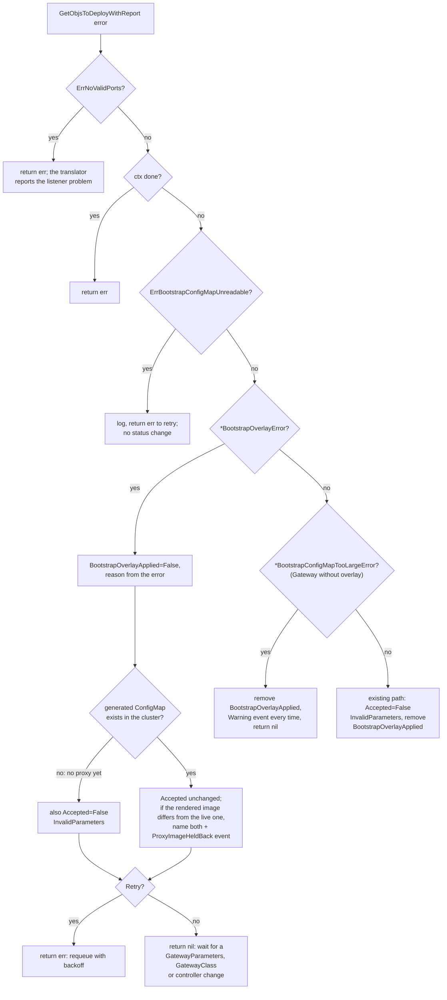
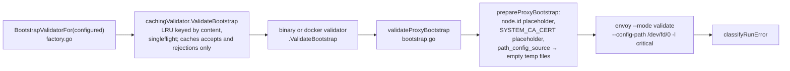
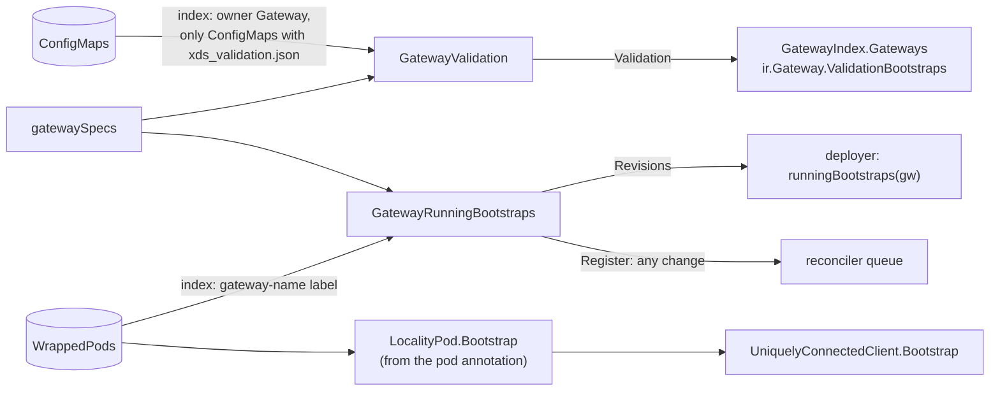

# Bootstrap overlays

A `GatewayParameters` can carry a partial Envoy bootstrap in
`spec.kube.envoyContainer.bootstrap.overlay`. The controller merges it into the
bootstrap the Helm chart generates, validates the result with Envoy, rolls it out to
the Gateway's proxy, and feeds what the proxy now accepts back into xDS translation.

This guide follows the bootstrap through the code: from the `GatewayParameters` field
to a running Envoy, then back from the cluster into translation. For why the feature
works this way, see the design,
[EP-13666](../../design/13666-envoy-bootstrap-config.md).

**Naming.** The API says *overlay* (`bootstrap.overlay`, `BootstrapOverlay`). Much of the Go
code says *overlay* for one resource's overlay: `bootstrapoverlay.Overlay`,
`InvalidOverlayError`, `BootstrapOverlayProvider.BootstrapOverlays`, `mergeOverlay`.
They mean the same thing.

## The big picture

The work falls into two loops, joined through what the deployer writes to the
cluster:

- **Deploy loop (leader only).** The Gateway reconciler renders the proxy objects,
  merges the overlay into the bootstrap, validates it with Envoy, writes it into the
  generated `ConfigMap` as a new *revision*, and rolls the pods.
- **Feedback loop (every replica).** KRT reads the validation data the deployer wrote
  to the `ConfigMap`. Translation validates routes and reserves listener ports
  against it. The publish gate holds a new proxy's first snapshot until a
  translation covers the bootstrap that proxy's pod started with.



Two facts hold the loops together:

- **Each pod carries the bootstrap it started with.** The pod template's
  `kgateway.dev/checksum-config` annotation names the pod's bootstrap revision, and
  `kgateway.dev/xds-validation-bootstrap` holds the parts of it that change what
  Envoy accepts. Pods keep their annotations for as long as they live.
- **Translation validates only against the current bootstrap,** the one in the
  `ConfigMap`'s `xds_validation.json` that new pods start with. The pod annotations
  are used to pick which revisions to keep and to decide when a new proxy's first
  snapshot may be published.

## Where the bootstrap lives

Every place a copy of the bootstrap, or a summary of it, is stored:

| # | Where | What it holds | Written by | Read by |
|---|---|---|---|---|
| 1 | `GatewayParameters.spec.kube.envoyContainer.bootstrap.overlay.value` | The user's partial `Bootstrap` as proto JSON, not validated by the API server | the user | `resolvedKgatewayParameters.bootstrapOverlays` |
| 2 | Rendered `ConfigMap` key `envoy.yaml` (in memory) | Helm's generated bootstrap | [`configmap.yaml`](../../pkg/kgateway/helm/envoy/templates/configmap.yaml) | `ApplyBootstrapOverlays`, as the merge base |
| 3 | `ConfigMap` key `envoy.yaml` (in the cluster) | The current bootstrap: merged when there is an overlay, otherwise generated. Kept for people and tools; pods read #4 | `ApplyBootstrapOverlays` overwrites it | envoyinit only when `INPUT_CONF` is unset |
| 4 | `ConfigMap` key `envoy-<sha256>.yaml` | One revision per bootstrap a pod, or a ReplicaSet with replicas, still uses | `writeBootstrapRevisions` | envoyinit, through `INPUT_CONF` |
| 5 | `ConfigMap` key `xds_validation.json` | `bootstrapoverlay.ValidationData` of the current bootstrap: the validation subset (static runtime layers) and the ports it listens on. Only for a Gateway with an overlay | `WriteBootstrapRevision` | KRT `GatewayValidation` |
| 6 | Pod-template annotation `kgateway.dev/checksum-config` | SHA-256 of the pod's bootstrap; names its revision key | Helm; `ApplyBootstrapOverlays` overwrites it for a Gateway with an overlay | Deployment rollout, KRT `GatewayRunningBootstraps`, `bootstrapRevisions` (ReplicaSets) |
| 7 | Pod-template annotation `kgateway.dev/xds-validation-bootstrap` | The same `ValidationData` as #5, for the bootstrap *this pod* started with | `WriteBootstrapRevision` | KRT `LocalityPod.Bootstrap` |
| 8 | Proxy container env `INPUT_CONF` | `/etc/envoy/envoy-<sha256>.yaml` | `writeBootstrapRevisions` | envoyinit |
| 9 | `/tmp/envoy.yaml` in the pod | The bootstrap after envoyinit's changes, for debugging | envoyinit | Envoy, through `--config-yaml` |
| 10 | Temporary dir in the controller | The copy validated with `envoy --mode validate` | `prepareProxyBootstrap` | the Envoy binary, or docker |

Rows 4 and 8 apply to every Gateway, with or without an overlay. The deployer goldens show the
revision key as `envoy-CHECKSUM.yaml`: `sanitizeRevisions` in
[`test/deployer/deployer_helm.go`](../../test/deployer/deployer_helm.go) checks that
the key and `INPUT_CONF` match the pod template's checksum, then replaces the
checksum.

## API and settings

| File | What it defines |
|---|---|
| [`gateway_parameters_types.go`](../../api/v1alpha1/kgateway/gateway_parameters_types.go) | `EnvoyBootstrap.Overlay`, `BootstrapOverlay{MergeStrategy, Value}`, and the `BootstrapMergeStrategy` enum with its one value, `StructuredMerge`. `Value` is `apiextensionsv1.JSON` with `PreserveUnknownFields`. Its doc comment is the user contract. |
| [`conditions.go`](../../api/conditions/conditions.go) | The `kgateway.dev/BootstrapOverlayApplied` condition and its reasons. |
| [`settings.go`](../../api/settings/settings.go) | `KGW_BOOTSTRAP_OVERLAY_MANAGED_PATHS`: `WARN` (default), `PRUNE` or `REJECT`. |
| [`role.yaml`](../../install/helm/kgateway/templates/role.yaml) | RBAC to watch `replicasets` and write `events.k8s.io` events. |
| [`helm_values_generator.go`](../../pkg/deployer/helm_values_generator.go) | The optional `ReportingObjectPostProcessor` interface and `PostProcessReport{Conditions, OwnedConditionTypes, Events}`, the way the deployer hands status back to the reconciler. |
| [`pkg/deployer/gateway_parameters.go`](../../pkg/deployer/gateway_parameters.go) | `deployer.Inputs.BootstrapValidator` and `BootstrapOverlayManagedPaths`. |
| [`ports.go`](../../pkg/kgateway/wellknown/ports.go) | `EnvoyReadinessPort` (8082), `EnvoyMetricsPort` (9091) and `EnvoyAdminPort` (19000). |

`controller/start.go` builds the bootstrap validator with
`validator.BootstrapValidatorFor` and passes it and the managed-path mode through
the controller config into `deployer.Inputs`.

## Deploy loop

### Call sequence



Entry points:

- `gatewayReconciler.Reconcile` in
  [`gw_controller.go`](../../pkg/kgateway/controller/gw_controller.go).
- `Deployer.GetObjsToDeployWithReport` in
  [`pkg/deployer/deployer.go`](../../pkg/deployer/deployer.go). It prefers
  `ReportingObjectPostProcessor` over `ObjectPostProcessor`.
- `GatewayParameters.PostProcessObjectsWithReport` in
  [`pkg/kgateway/deployer/gateway_parameters.go`](../../pkg/kgateway/deployer/gateway_parameters.go).
  Read this first in the deployer: it fixes the order of every step below.

### Order of steps in `PostProcessObjectsWithReport`

1. **Collect the overlays.** `resolvedKgatewayParameters.bootstrapOverlays` (in
   [`bootstrap_overlays.go`](../../pkg/kgateway/deployer/bootstrap_overlays.go))
   returns the GatewayClass's overlay, then the Gateway's. A `GatewayParameters`
   referenced by both counts once.
2. **Let an override choose.** If the `HelmValuesGenerator` override implements
   `BootstrapOverlayProvider`, its `BootstrapOverlays` receives those overlays and
   returns the final list (see [Override `HelmValuesGenerator`](#override-helmvaluesgenerator)).
3. **Merge** with `ApplyBootstrapOverlays`, before the object overlays, so a
   `deploymentOverlay` can still change any object. With no bootstrap overlays this step is
   skipped and `ForgetBootstrapOverlayMetrics` clears the Gateway's metric series.
4. **Post-process the objects:** the `GatewayParameters` object overlays, or the
   override's `PostProcessObjects`.
5. **Write the revision** with `writeBootstrapRevisions`, after the object overlays,
   so the mount check (`BootstrapMountProblem`) sees the final volumes and env. The
   check reports a problem when something other than the whole generated
   `ConfigMap` is mounted at `/etc/envoy`, or when the proxy container's env sets
   `INPUT_CONF` to a file outside `/etc/envoy`; the rendered `Deployment` has no
   `INPUT_CONF` at that point, so one found there is the user's. This runs for
   every Gateway.
6. **Reserve Service ports** with `ReserveServicePorts`, after the object overlays
   so a `serviceOverlay` cannot add a reserved port back. Only for a Gateway
   with an overlay whose proxy mounts the generated `ConfigMap`.
7. **Build the report:** `bootstrapOverlayAppliedCondition` and `bootstrapOverlayEvents`.

When the merge fails, the deployer still runs step 4 on the objects without the overlay, only
to learn which proxy image the failure holds back (`withRenderedProxy`).

### `ApplyBootstrapOverlays`

In [`bootstrap_overlays.go`](../../pkg/kgateway/deployer/bootstrap_overlays.go), in
order:

| Step | Code | Failure reason |
|---|---|---|
| Find and parse the generated bootstrap | `findBootstrapConfigMap`, `bootstrapoverlay.ParseBootstrap` | `ControllerError` |
| Merge | `bootstrapoverlay.Apply(base, overlays, mode)` (see [Merge engine](#merge-engine-pkgkgatewaybootstrapoverlay)) | `InvalidOverlay` (`*InvalidOverlayError`), `PathsDenied` (`*ManagedPathsDeniedError`) |
| Encode the validation subset | `ValidationSubset`, `EncodeValidationSubset` | `InvalidOverlay` when over 64 KiB, since it goes on a pod annotation |
| Validate the merged bootstrap with Envoy | `cfg.Validator.ValidateBootstrap` (see [Validating with Envoy](#validating-the-merged-bootstrap-with-envoy-pkgvalidator)) | `ValidationFailed`; `ValidationUnavailable`, with `Retry` set only for a transient failure |
| Write it back | `bootstrapoverlay.Marshal` into `envoy.yaml`; its SHA-256 into `kgateway.dev/checksum-config` | `ControllerError` |
| Encode the validation data | `ListenerPorts`, `EncodeValidationData` | `ControllerError` |

The result, `BootstrapOverlayOutcome`, carries the merged YAML, checksum and encoded
validation data in private fields, so only `WriteBootstrapRevision` writes them and
nothing can write a revision that was not validated. Its public fields feed the
condition message.

### Revisions in the `ConfigMap`

Every pod mounts the same `ConfigMap`, and kubelet updates a mounted `ConfigMap` in
place. If pods read `envoy.yaml`, a container that restarts mid-rollout would load
the new bootstrap while its annotations still describe the old one. So each
revision gets its own key, and each pod is pointed at its own.

Example: Gateway `gw`, overlay changed from revision `aaa…` to `bbb…`, rollout in
progress.

```yaml
# ConfigMap gw (owned by Gateway gw)
data:
  envoy.yaml: |          # current bootstrap (= bbb…), for people and tools
    ...
  envoy-bbb….yaml: |     # current revision; new pods read this
    ...
  envoy-aaa….yaml: |     # kept: an old pod or old ReplicaSet still uses it
    ...
  xds_validation.json: '{"bootstrap":{"layered_runtime":{...}},"reservedPorts":[8082,9091,19000]}'
  # xds_ca_sds.json, ca.crt, ... unchanged; they rotate in place
---
# Deployment gw, pod template
metadata:
  annotations:
    kgateway.dev/checksum-config: bbb…
    kgateway.dev/xds-validation-bootstrap: '{"bootstrap":{...},"reservedPorts":[...]}'
spec:
  containers:
  - name: kgateway-proxy
    env:
    - name: INPUT_CONF
      value: /etc/envoy/envoy-bbb….yaml
    volumeMounts:
    - name: envoy-config        # must be the whole generated ConfigMap at /etc/envoy
      mountPath: /etc/envoy
```

`GatewayParameters.writeBootstrapRevisions` (in
[`pkg/kgateway/deployer/gateway_parameters.go`](../../pkg/kgateway/deployer/gateway_parameters.go)):

1. `BootstrapMountProblem` checks that the `kgateway-proxy` container mounts the
   **whole** generated `ConfigMap` at `/etc/envoy`: no other `ConfigMap` or volume,
   no `subPath`, no `items`.
2. `bootstrapRevisions` works out which revisions are in use:
   - `GatewayRunningBootstraps.Revisions`: the checksums of the Gateway's pods that
     have not exited, from KRT.
   - The checksum of each ReplicaSet of the proxy `Deployment` with replicas above
     zero, which can still create a pod.
   - The `ConfigMap`, from the informer (`kgatewayParameters.configMapClient`) when
     that copy holds a key for every revision in use other than the one this
     reconcile writes (`missingRevisions`), and otherwise with a **direct GET**
     (`kgatewayParameters.getConfigMap`). A revision key names the SHA-256 of its
     content (the merged bootstrap's, or Helm's `sha256sum` of `envoy.yaml`), so a
     stale copy can only lack a key, never hold wrong content for one, and a
     missing key is what triggers the GET. Outside a rollout every revision in use
     is the current one, so no GET happens. From the API server, any error other
     than NotFound returns `ErrBootstrapConfigMapUnreadable`, and the reconciler
     retries without touching status or objects. Under a mount problem no revision
     is written, so every revision in use counts.
3. Then one of:



**Pruning is omission.** A revision no longer in use is left out of the rendered
`ConfigMap`, and server-side apply removes it. A revision in use is never dropped to
make room: when the `ConfigMap` would exceed 1 MiB, the result is a
`BootstrapConfigMapTooLargeError`, whose message says whether the new bootstrap or
the revisions still held caused it. It is wrapped in a `BootstrapOverlayError` with
reason `BootstrapConfigMapTooLarge` for a Gateway with an overlay, and reported as a
`Warning` event for one without.

Two watches make the reconciler run again when a revision frees up (in
`NewGatewayReconciler`):

- `GatewayIndex.RunningBootstraps.Register`: the revisions the Gateway's pods run
  changed.
- The ReplicaSet client's handler: maps a ReplicaSet to its `Deployment`, then to its
  Gateway.

The reconciler waits for `RunningBootstraps` and the ReplicaSet informer to sync
before its first reconcile, so a controller restart does not read an empty pod set
as no pods and prune a key a pod still mounts. A controller without the
`apps/replicasets` rule never finishes that sync and reconciles no Gateway.

### Service ports

`GetPortsValues` leaves the constant reserved ports (8082, 9091, 19000) off the
`Service`, for every Gateway. For a Gateway with an overlay, `ReserveServicePorts` also
removes each Gateway listener port the merged bootstrap listens on
(`BootstrapOverlayOutcome.BootstrapPorts`), records them in `RemovedServicePorts` for
the condition message, and returns `InvalidOverlay` if that would leave the `Service`
with no ports. It is skipped when the proxy does not mount the generated
`ConfigMap`, since the proxy then listens on the default ports only.

### Reporting

- `bootstrapOverlayAppliedCondition` builds the condition from the outcome and the
  mount problem: `Applied`, `ManagedPathsOverridden`, `PathsIgnored`, or
  `BootstrapNotMounted`. The message lists the managed paths and the ports left off
  the `Service`; for `BootstrapNotMounted` it gives only the mount problem. An overlay
  that fails the merge or validation returns a `BootstrapOverlayError` before the
  mount check, so it takes the fallback even when the bootstrap is not mounted.
  `PostProcessObjectsWithReport` then runs `BootstrapMountProblem` on the objects it
  did not apply and sets `BootstrapOverlayError.MountProblem`; the reconciler appends
  `MountNote()` after the cut overlay error, so the message says the overlay has no
  effect on the proxy and that removing it deploys the held-back objects.
- `bootstrapOverlayEvents` returns one `Warning` event per managed path, or one for
  `BootstrapNotMounted`. `BootstrapOverlayError.Events` returns one per denied path
  for `PathsDenied`, otherwise one for the failure.
- `recordBootstrapOverlayManagedPaths` in
  [`metrics.go`](../../pkg/kgateway/deployer/metrics.go) sets the gauge
  `kgateway_controller_bootstrap_overlay_managed_paths{namespace,name,path}`.
- The report's `OwnedConditionTypes` lists `kgateway.dev/BootstrapOverlayApplied`, so
  the reconciler removes the condition when the report does not set it, for
  example when the overlay is removed.
- The reconciler's `applyGatewayConditions` writes the conditions and records the
  events only when a condition's status, reason or message changes, so reconciles
  that change nothing do not repeat events.
- Without a report, as for a self-managed Gateway, the reconciler removes a
  `BootstrapOverlayApplied` condition the Gateway still has and forgets its metric.
- `truncateText` keeps text within the API server's limits: an overlay error is cut
  to 4096 bytes before it goes into a condition message, `applyGatewayConditions`
  cuts each message to 32768 bytes before it compares it with the stored one, and
  `recordEvents` cuts each note to 1024 bytes. The full text is logged.
- The translator preserves the condition when it writes Gateway status
  (`shouldPreserveGatewayCondition` in
  [`pkg/reports/status.go`](../../pkg/reports/status.go)).

### Failure handling in the reconciler

On every failure path, **none of the Gateway's objects are applied**, so a running
proxy keeps its last-good bootstrap. The generated `ConfigMap` is one of those
objects, so with xDS TLS enabled a Gateway on a failure path does not receive a
replaced `ca.crt` until the overlay is fixed.



The held-back image comes from `HeldBackProxyImage` in
[`proxy_image.go`](../../pkg/kgateway/deployer/proxy_image.go), which compares the
proxy container image in the live `Deployment` with the one the deployer rendered.

## Merge engine: `pkg/kgateway/bootstrapoverlay`

A package with no Kubernetes types; everything is Envoy protos. Read it after
`ApplyBootstrapOverlays`.

| File | Role |
|---|---|
| [`types.go`](../../pkg/kgateway/bootstrapoverlay/types.go) | Blank-imports `pkg/utils/filter_types`, so `protojson` can resolve every `@type` go-control-plane defines, plus the cncf/xds `TypedStruct` wrappers. |
| [`parse.go`](../../pkg/kgateway/bootstrapoverlay/parse.go) | `ParseBootstrap` (YAML to JSON to `protojson`). `parseOverlay` parses strictly and rejects `{{` after re-marshalling, so a JSON escape cannot hide it. `Marshal` writes snake_case YAML with sorted keys, so the checksum is stable across builds. |
| [`apply.go`](../../pkg/kgateway/bootstrapoverlay/apply.go) | `Apply`, the reserved-name checks, and the runtime layer name check. |
| [`merge.go`](../../pkg/kgateway/bootstrapoverlay/merge.go) | `mergeOverlay` and the list and `Any` rules. |
| [`managed.go`](../../pkg/kgateway/bootstrapoverlay/managed.go) | `managedPaths`, `checkNewStaticNames` (the `user_` prefix), `prune`. |
| [`ports.go`](../../pkg/kgateway/bootstrapoverlay/ports.go) | `ListenerPorts`: the admin port and each static listener's address and additional addresses. UDP, pipe and internal addresses are skipped. |
| [`validation.go`](../../pkg/kgateway/bootstrapoverlay/validation.go) | `ValidationSubset` (static runtime layers only), its canonical encoding, `ValidationData`, and the key and annotation names. |

### `Apply`

```text
for each overlay, all checked before any is merged, so the errors and REJECT list
every problem and every path:
  parseOverlay          strict protojson; unknown field or `{{` anywhere → error,
                        and skip the checks below
  checkReserved         SYSTEM_CA_CERT secret; non-static runtime layer;
                        a name repeated within one overlay
  checkNewStaticNames   new static cluster or listener without the user_ prefix
  claimLayers           runtime layer name used by the base or an earlier overlay
  managedPaths          record each managed path it sets
  PRUNE → prune(base, overlay)
any check failed → errors.Join of the InvalidOverlayErrors
REJECT and any managed path → ManagedPathsDeniedError
merged = clone(base); mergeOverlay(merged, overlay) for each, in order
```

Each problem the per-overlay checks find is its own `InvalidOverlayError` naming the
source resource, under every mode. A check reads only its overlay, the base and the
runtime layer names of earlier overlays, never a merged result, so one invalid
overlay does not hide another's problems. `Apply` joins the errors with
`errors.Join`, so the condition message has one line per problem.

### Merge rules

| Shape | Rule | How |
|---|---|---|
| scalar | overlay replaces | `proto.Merge` |
| message | merged field by field | `proto.Merge` |
| `google.protobuf.Any` | overlay replaces whole | `clearReplacedAnys` clears the base's `Any` first; otherwise `proto.Merge` would merge payloads under the overlay's type URL |
| map entry | overlay replaces whole | `proto.Merge` |
| ordinary list | overlay entries **before** base entries | `proto.Merge` appends, then `prependOverlayEntries` / `moveLastToFront` |
| `static_resources.{clusters,listeners,secrets}`, `overload_manager.resource_monitors` | merged **by name**: the same name replaces whole, a new name appends | `mergeByName` |
| `layered_runtime.layers` | inserted just **before the admin layer** | `slices.Insert` at the admin layer's index |

### Managed paths

`managedPaths` reports:

- `node`, `dynamic_resources`, `admin.address` and
  `cluster_manager.local_cluster_name`, when the overlay sets them.
- Every overlay entry in the four named lists whose name matches an entry of the
  **generated** bootstrap, as `static_resources.clusters[name=xds_cluster]` and so
  on. The names come from the base passed in, so a generated entry a later release
  adds is managed with no code change.

`WARN` applies them, `PRUNE` drops them with `prune`, `REJECT` fails the whole set.

`checkNewStaticNames` rejects a static cluster or listener that neither has a
generated entry's name nor starts with `UserNamePrefix` (`user_`). Envoy ignores a
cluster or listener from xDS that has a static one's name, so an entry with a
translated name would take a backend's or Gateway listener's place.
`NewBackendObjectIR`'s doc comment in
[`pkg/pluginsdk/ir/backend.go`](../../pkg/pluginsdk/ir/backend.go) tells plugins not to
use a `user` cluster name prefix.

## Validating the merged bootstrap with Envoy: `pkg/validator`



`BootstrapValidator` is separate from the xDS `Validator`.
`BootstrapValidatorFor` reuses the configured validator when it can validate
bootstraps. The prepared copy matches what the pod runs: Envoy in the pod gets
`node.id` from `--service-node` and the CA secret from envoyinit, so the validator
adds stand-ins for both.

`prepareProxyBootstrap` leaves TLS file paths in place. Envoy opens each TLS file
the bootstrap names when it loads it, and a file mounted only in the proxy pod is
not in the controller container, so an overlay that names one gets
`ValidationFailed`. An overlay can give public TLS material (a CA, a CRL) inline or
trust `SYSTEM_CA_CERT`; a private key given inline would be stored in the
`GatewayParameters` and the generated `ConfigMap`, so mutual TLS from an overlay
waits for file support.
Validating TLS files with placeholders, as xDS validation does for translated
resources with the helper in
[`tls_files.go`](../../pkg/xds/bootstrap/tls_files.go), is a follow-up: that helper
covers only the certificate, key and CA, and a CRL, a PKCS#12 bundle and an OCSP
staple each need their own placeholder.

`classifyRunError` (and the docker runner's exit-code handling) sorts the result:

| Envoy outcome | Error | Reason | Retried? |
|---|---|---|---|
| Envoy exits non-zero, or crashes on a signal other than SIGKILL | `ErrInvalidBootstrap` | `ValidationFailed` | no |
| Binary or docker missing, image has no Envoy (docker 126/127), temp dir not writable, configured validator cannot validate bootstraps | `ErrBootstrapValidatorUnavailable` | `ValidationUnavailable` | no; a controller `Deployment` or settings change restarts the controller |
| Timeout, SIGKILL (likely OOM), docker 125, full disk | other error | `ValidationUnavailable` | yes |
| The caller's context ended | context error | none; the controller is stopping | n/a |

## Inside the proxy pod: `pkg/envoyinit`

`RunEnvoy` in [`run.go`](../../pkg/envoyinit/run.go):

1. **`waitForInputConfig`** ([`wait.go`](../../pkg/envoyinit/wait.go)). When
   `INPUT_CONF` names a file inside `/etc/envoy`, poll every second until the file
   exists; a file elsewhere is the user's, and a missing one fails at once. Kubelet serves
   `ConfigMap` volumes from a watch-based cache, so a pod created right after the
   `ConfigMap` write can see content without its revision key. There is no time
   limit; the startup probe bounds the wait.
2. **`getAndTransformConfig`**: the `text/template` pass over the whole file (the
   reason overlays cannot contain `{{`) and the `node.locality` edit.
3. **`addSystemCASecret`** ([`system_ca.go`](../../pkg/envoyinit/system_ca.go))
   appends the `SYSTEM_CA_CERT` static secret by editing the bootstrap as YAML, not
   as a `Bootstrap` proto. envoyinit therefore does not need to link every `@type` an
   overlay might use; Envoy alone decides whether the bootstrap is valid.
4. Write `/tmp/envoy.yaml`, then exec Envoy.

## Feedback loop: what translation knows about the bootstrap

### KRT collections



Both collections live in
[`validation_bootstraps.go`](../../pkg/krtcollections/validation_bootstraps.go) and
are built in `NewGatewayIndex` in
[`policy.go`](../../pkg/krtcollections/policy.go):

- **`GatewayValidation`** decodes `xds_validation.json` from the `ConfigMap` the
  Gateway owns into `ir.GatewayValidationBootstraps{Subset, ReservedPorts}`
  ([`validation_bootstrap.go`](../../pkg/pluginsdk/ir/validation_bootstrap.go)). It
  is `nil` when the Gateway has no validation data: Envoy's defaults and the
  constant ports. Its `Equals` compares the encoded subset and ports, so a change to
  another `ConfigMap` key stops there and does not re-run Gateway translation.
- **`GatewayRunningBootstraps`** collects the distinct `checksum-config` values of
  the Gateway's pods that have not exited. Only the deployer and the reconciler's
  requeue use it; translation does not.

`NewGatewayIndex` sets `ir.Gateway.ValidationBootstraps` in the wrapper around the
Gateway transformation, not inside it, so a custom
`WithGatewayForEnvoyTransformationFunc` also gets it.

A pod's own annotation reaches xDS separately: `podBootstrapFromAnnotations` fills
`LocalityPod.Bootstrap` in [`pods.go`](../../pkg/krtcollections/pods.go), and
`deriveClientIdentity` in
[`uniqueclients.go`](../../pkg/krtcollections/uniqueclients.go) copies it onto the
connecting client. A pod without the annotation gets Envoy's defaults and the
constant ports, which covers pods started before the feature existed.

### Consumers of `ir.Gateway.ValidationBootstraps`

1. **Route validation.** `validatorForGateway` in
   [`gateway_validator.go`](../../pkg/kgateway/translator/irtranslator/gateway_validator.go)
   wraps the strict-mode validator when the Gateway has a non-empty subset.
   `gatewayValidator.Validate` appends the subset's runtime layers to each
   validation bootstrap. It is passed into every validation call for the Gateway's
   routes. Policy and backend validation do not go through it and keep Envoy's
   defaults.
2. **Listener ports.** `validate.ListenerPortForBootstrap` in
   [`validate/gateway.go`](../../pkg/kgateway/validate/gateway.go), called from
   [`listener/validation.go`](../../pkg/kgateway/translator/listener/validation.go),
   rejects the constant ports and the current bootstrap's ports. The message says
   when the overlay is the reason.
3. **Bootstrap coverage.** `newBootstrapCoverage` in
   [`bootstrap_coverage.go`](../../pkg/kgateway/proxy_syncer/bootstrap_coverage.go)
   records the subset and reserved ports each translation was validated under, on
   the proxy syncer's per-Gateway resources (`validatedBootstraps`). It is part of
   `Equals`, so a translation that changes only its coverage still propagates.

### Holding a new proxy's first snapshot

```mermaid
sequenceDiagram
    autonumber
    participant Pod as New proxy pod (revision bbb)
    participant XDS as xDS server
    participant KRT as KRT (pods)
    participant TR as Translation
    participant PC as snapshotPerClient
    participant G as publishGate

    Pod->>XDS: connect (node.metadata.role)
    XDS->>KRT: deriveClientIdentity: find the pod
    KRT-->>XDS: LocalityPod.Bootstrap = {subset bbb, ports}
    Note over XDS: client.Bootstrap set; the client key<br/>includes pod-template-hash, so one key per ReplicaSet
    PC->>PC: bootstrapUnvalidated = !coverage.covers(client.Bootstrap)
    PC->>G: XdsSnapWrapper(bootstrapUnvalidated=true)
    G->>G: holdUnvalidatedBootstrapLocked:<br/>not published, not warm, pod not Ready → hold, log once
    KRT->>TR: GatewayValidation now holds bbb
    TR->>PC: new translation, coverage = bbb
    PC->>G: XdsSnapWrapper(bootstrapUnvalidated=false)
    G->>Pod: setSnapshot (logs the release)
```

`perclient.go` sets `bootstrapUnvalidated` from `bootstrapCoverage.covers`, and
`XdsSnapWrapper.Equals` compares it, so a translation that changes only coverage
still produces a build that releases the hold. `holdUnvalidatedBootstrapLocked` in
[`publish_gate.go`](../../pkg/kgateway/proxy_syncer/publish_gate.go) holds only a
cold client's first build. It never holds a client that:

- was already published to on this connection;
- is warm: it reported a previously accepted xDS version;
- has a stream admitted while its pod was Ready (`HasReadyPodStream` in
  `uniqueclients.go`). A reconnecting Envoy sends its listener request only after
  CDS, so until then its pod's readiness is the only thing that tells it from a new
  proxy.

Usually there is no hold: the deployer applies the `ConfigMap` before the
`Deployment` (`SortByKindPriority` in `pkg/deployer/deployer.go`), so translation
already covers a new pod's bootstrap when it connects. The hold matters when
translation lags, and for a pod from an old ReplicaSet whose Envoy restarts
mid-rollout: no translation covers it, so it stays unready until the rollout
removes it. The hold has no time limit. The first-publish time limit, which bounds
the wait for referenced clusters, does not bound the hold; once released, a build
still waiting for referenced clusters gets only what remains of that limit. With
pod locality off
(`DISABLE_POD_LOCALITY_XDS=true`) a client has no pod and is never held.

## A change, end to end

The user edits an overlay on a running Gateway, changing its bootstrap from revision
`aaa` to `bbb`.

```mermaid
sequenceDiagram
    autonumber
    participant U as User
    participant R as Reconciler
    participant K as Kubernetes
    participant P as KRT + translator
    participant O as Old pods (aaa)
    participant N as New pods (bbb)

    U->>K: update GatewayParameters
    K->>R: GatewayParameters event → reconcile
    R->>R: merge, validate, envoy-bbb.yaml, keep envoy-aaa.yaml,<br/>xds_validation.json = bbb, pod-template annotations = bbb
    R->>K: apply ConfigMap, Deployment, Service
    K->>P: xds_validation.json changed
    P->>P: routes validated under bbb;<br/>listeners on bbb's ports rejected
    P->>O: same xDS; an old pod rejects a RouteConfiguration<br/>only bbb accepts and keeps its last one
    K->>N: new ReplicaSet creates pods (INPUT_CONF = envoy-bbb.yaml)
    N->>N: envoyinit waits for the key if kubelet lags
    N->>P: connect; covered by bbb → snapshot sent
    K->>K: old ReplicaSet scaled to 0, old pods exit
    K->>P: GatewayRunningBootstraps: only bbb
    P->>R: RunningBootstraps event + ReplicaSet event → reconcile
    R->>K: apply ConfigMap without envoy-aaa.yaml
```

## Override `HelmValuesGenerator`

A project that embeds kgateway can replace Helm value generation with
`GatewayParameters.WithHelmValuesGeneratorOverride`. What happens to bootstrap
overlays depends on the interfaces the override implements:

| Override implements | Behavior |
|---|---|
| neither `ObjectPostProcessor` nor `BootstrapOverlayProvider` | kgateway's `GatewayParameters` bootstrap overlays and object overlays apply as usual |
| `ObjectPostProcessor` only | The override's post-processor replaces the bootstrap overlays and the object overlays: no bootstrap overlays, no condition. The Gateway still gets a bootstrap revision and `INPUT_CONF` |
| `BootstrapOverlayProvider`, with or without `ObjectPostProcessor` | The override chooses the bootstrap overlays; `Source.Kind` names its own resource in messages. kgateway merges, validates and reports, and the override's post-processor runs after the merge |

## Tests

| Area | Tests |
|---|---|
| Merge engine | [`apply_test.go`](../../pkg/kgateway/bootstrapoverlay/apply_test.go), [`parse_test.go`](../../pkg/kgateway/bootstrapoverlay/parse_test.go), [`validation_test.go`](../../pkg/kgateway/bootstrapoverlay/validation_test.go) |
| Deployer | [`bootstrap_overlays_test.go`](../../pkg/kgateway/deployer/bootstrap_overlays_test.go) (revisions, pruning, size limit, ports, mount check, condition, metric), [`bootstrap_parse_test.go`](../../pkg/kgateway/deployer/bootstrap_parse_test.go), and the deployer goldens in [`test/deployer/testdata`](../../test/deployer/testdata) |
| Reconciler | [`controller_test.go`](../../pkg/kgateway/controller/controller_test.go) |
| Envoy validation | `pkg/validator` tests |
| envoyinit | [`wait_test.go`](../../pkg/envoyinit/wait_test.go), [`system_ca_test.go`](../../pkg/envoyinit/system_ca_test.go) |
| KRT | [`validation_bootstraps_test.go`](../../pkg/krtcollections/validation_bootstraps_test.go), [`pod_bootstrap_test.go`](../../pkg/krtcollections/pod_bootstrap_test.go), [`uniqueclients_test.go`](../../pkg/krtcollections/uniqueclients_test.go) |
| Translator | [`gateway_validator_test.go`](../../pkg/kgateway/translator/irtranslator/gateway_validator_test.go) (real Envoy, with bootstraps that raise and lower the RE2 program-size limit), [`validate/gateway_test.go`](../../pkg/kgateway/validate/gateway_test.go), goldens under `pkg/kgateway/translator/gateway/testutils/{inputs,outputs}/bootstrap-validation/` |
| Publish gate | [`bootstrap_coverage_test.go`](../../pkg/kgateway/proxy_syncer/bootstrap_coverage_test.go) |
| E2E | [`test/e2e/features/bootstrapoverlays`](../../test/e2e/features/bootstrapoverlays/suite.go): `TestOverlayApplied`, `TestManagedPathModes`, `TestFragmentFeatureFlag`, `TestStaticNamePrefix` |

## Suggested reading order

1. **API:** `gateway_parameters_types.go` (`BootstrapOverlay`), `conditions.go`,
   `settings.go`.
2. **Merge engine:** `bootstrapoverlay/apply.go`, then `merge.go`, `managed.go`,
   `validation.go`.
3. **Deployer:** `PostProcessObjectsWithReport` in
   `pkg/kgateway/deployer/gateway_parameters.go`, then `ApplyBootstrapOverlays`,
   `writeBootstrapRevisions` and `WriteBootstrapRevision`, `ReserveServicePorts`,
   and `bootstrapOverlayAppliedCondition` in `bootstrap_overlays.go`.
4. **Validator:** `pkg/validator/bootstrap.go`, `cache.go`, `factory.go`.
5. **Reconciler:** `gw_controller.go`: the error branches in `Reconcile`,
   `applyGatewayConditions`, and the watches in `NewGatewayReconciler`.
6. **Pod side:** `pkg/envoyinit/run.go`, `wait.go`, `system_ca.go`.
7. **Feedback loop:** `krtcollections/validation_bootstraps.go`,
   `pluginsdk/ir/validation_bootstrap.go`, `NewGatewayIndex` in
   `krtcollections/policy.go`, `irtranslator/gateway_validator.go`,
   `validate/gateway.go`.
8. **xDS delivery:** `krtcollections/pods.go` and `uniqueclients.go`, then
   `proxy_syncer/bootstrap_coverage.go`, `perclient.go` and `publish_gate.go`.
